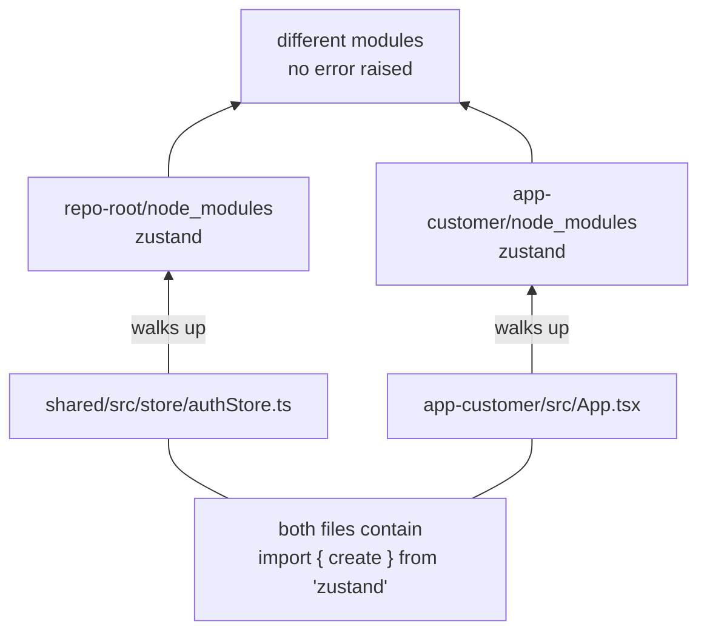

# Splitting one React Native app into two

**One RN app with two user roles became two apps on both stores, sharing a 64-file package. Here is what broke, in the order it broke.**

Metro resolves a file's imports from that file's own location. The shared file and the app file walk up into different `node_modules` trees, both lookups succeed, and nothing is logged. The app now holds two copies of a module that only works as one. [Doc 02](docs/02-metro-duplicate-instances.md) is entirely about this.

Most "React Native monorepo" guides stop at `watchFolders`. That gets you a bundle that builds. It does not get you an app that works, because the interesting failures are not resolution errors. They are silent duplicate instances: you log in on a shared screen and the app never notices, or a hook throws `Cannot read property 'current' of null` in a file you did not touch.

This is a field report from a real split, not a tutorial written from the docs.

**Setup:** React Native 0.84, React 19, npm (not Yarn, not pnpm), bare workflow (no Expo), one customer app and one service-provider app, both live on Google Play and the App Store. Shared package is pure TypeScript, 64 files: theme, API client, auth store, constants, types, utils, a few components and the auth screens.

---

## Contents

| Doc | What it covers |
|---|---|
| [01. The layout](docs/01-the-layout.md) | Three packages, and why **neither app is an npm workspace member** |
| [02. Metro and duplicate instances](docs/02-metro-duplicate-instances.md) | The flagship problem. Why `watchFolders` alone gives you two Reacts |
| [03. TypeScript and npm](docs/03-typescript-and-npm.md) | Why the shared package declares **zero dependencies**, and why `tsc` passing proves nothing |
| [04. Native identity](docs/04-native-identity.md) | Two application ids, two Firebase apps, two keystores, two Maps SHA-1 rows |
| [05. Failure catalogue](docs/05-failure-catalogue.md) | Every symptom we hit, with the cause and the fix |
| [06. Governing shared code](docs/06-governing-shared-code.md) | A shared package is two shipped products. Fork vs restyle, and drift |

Runnable examples are in [`examples/`](examples/). A copyable pre-commit check is in [`scripts/`](scripts/).

---

## The short version

If you read nothing else:

1. **Keep both RN apps out of your npm workspaces.** Put only the shared package in. Each app gets a complete, unhoisted `node_modules` and pulls the shared package in as `file:../shared`. A workspace install can leave an incomplete copy of `@react-native/gradle-plugin` in the app's own `node_modules`, shadowing the good one, and the Android build then dies at settings evaluation with `Plugin [id: 'com.facebook.react.settings'] was not found`.

2. **`watchFolders` is half the fix.** It makes Metro *serve* files outside the project root. It does nothing about *how those files resolve their own imports*. A shared file importing `zustand` walks up from the shared folder to the repo root and finds the root copy, while your app code finds the app copy. Two instances, no error.

3. **Pin every shared dependency with `resolveRequest`.** Enumerate every bare import in your shared package and force it to the host app's copy. The list is short and finite. See [doc 02](docs/02-metro-duplicate-instances.md).

4. **The shared package declares no dependencies at all.** Not `dependencies`, not `peerDependencies`. The host app owns every native module. Declaring peers makes npm try to satisfy them at the repo root, where your web packages pin an older React, and you get a permanent `ERESOLVE`.

5. **Mirror the Metro pins in `tsconfig.json` paths.** Metro and `tsc` resolve independently. If only one is pinned, the other one lies to you.

6. **Green `tsc` is not proof the split works.** It is proof the types line up. Duplicate-instance bugs are invisible to the type checker by construction. Only a device run finds them.

7. **Delete your role-picker screen.** In a two-app world, the app someone installed *is* the role choice. Each app hardcodes its role at registration.

---

## The one-paragraph version of why

A shared package in a monorepo is not a library. A published library gets installed *into* each consumer's `node_modules`, so each consumer gets its own resolved copy of everything and Node's algorithm does the right thing. A `file:` or workspace-linked package physically lives somewhere else, and its imports resolve from *its* location, not from the app importing it. Every duplicate-instance bug in this repo comes from that single fact.

---

## What this is not

- Not Expo. Expo's monorepo support solves some of this for you.
- Not pnpm or Yarn Berry. Their linking strategies change which of these bugs you get, not whether you get them.
- Not a template to clone. It is a set of decisions with the reasoning attached, so you can tell which ones apply to you.

## Lice

M
